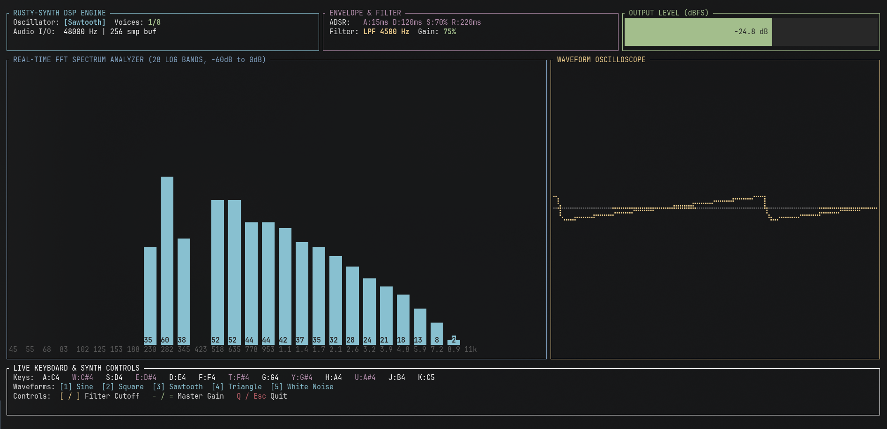

# rusty-synth

**`rusty-synth`** is a low-latency, real-time polyphonic terminal audio synthesizer and live FFT frequency spectrum visualizer written in Rust. Designed with strict real-time DSP systems engineering principles, the audio callback operates with **zero heap allocations, zero locks, and zero system calls**.


### Application Screenshot

<p align="center">
  
</p>


```


```

## Key Features

* **Lock-Free Real-Time Audio Engine**: Powered by `cpal` at `48,000 Hz` or `44,100 Hz` with ultra-low `256`-sample hardware buffers.

* **Anti-Aliased Waveforms**: Supports **Sine**, **PolyBLEP Square**, **PolyBLEP Sawtooth**, **Triangle**, and deterministic **Xorshift32 White Noise**.

* **8-Voice Polyphony**: Dynamic voice manager with intelligent voice stealing (prioritizes idle voices, then the oldest voice in its `Release` phase).

* **Click-Free ADSR Envelopes**: Per-voice linear Attack-Decay-Sustain-Release state machine with smooth re-triggering.

* **Master Low-Pass Filter & Soft Limiter**: Unconditionally stable one-pole low-pass filter (`120 Hz` – `18,000 Hz`) paired with a `tanh` saturation stage.

* **Real-Time 2,048-Point FFT Visualizer**: Dedicated worker thread running `rustfft` with a Hann window, mapped across 28 logarithmically spaced musical frequency bins (`-60 dB` to `0 dB`) alongside a Braille time-domain oscilloscope.

## Controls & Keybindings

### Chromatic Piano Keyboard (Home Row)

```
   ┌───┬───┐   ┌───┬───┬───┐ 
   │ W │ E │   │ T │ Y │ U │ 
   │C#4│D#4│   │F#4│G#4│A#4│   
 ┌─┴───┴───┴───┴───┴────┴──┴────┬
 │ A │ S │ D │ F │ G │ H │ J │ K│ 
 │C4 │D4 │E4 │F4 │G4 │A4 │B4 │C5│ 
 └───┴───┴───┴───┴───┴───┴───┴──┴


```

### Synth Parameters

| Key | Action | Description | 
| ----- | ----- | ----- | 
| `A` `W` `S` `E` `D` `F` `T` `G` `Y` `H` `U` `J` `K` | **Play Notes** | Triggers MIDI notes `60` (`C4`) through `72` (`C5`) | 
| `1` | **Sine Wave** | Pure fundamental tone | 
| `2` | **Square Wave** | Hollow, woody odd-harmonic waveform (PolyBLEP anti-aliased) | 
| `3` | **Sawtooth Wave** | Bright, brassy even+odd harmonic waveform (PolyBLEP anti-aliased) | 
| `4` | **Triangle Wave** | Warm, flute-like waveform | 
| `5` | **White Noise** | Flat-spectrum noise via zero-syscall Xorshift32 PRNG | 
| `[` / `]` | **Filter Cutoff** | Sweeps the master low-pass filter cutoff down / up | 
| `-` / `=` | **Master Gain** | Decreases / increases master output volume (`5%` – `150%`) | 
| `Q` / `Esc` | **Quit** | Gracefully stops threads and restores terminal state | 

## System Architecture

`rusty-synth` splits execution across three decoupled threads communicating strictly via lock-free atomics and bounded `crossbeam-channel` queues:

1. **Real-Time Audio Thread (`src/audio/stream.rs`)**:

   * Driven by the OS audio callback (`CoreAudio`, `ALSA`, or `WASAPI`).

   * Polls `NoteOn`/`NoteOff` events via non-blocking `try_recv()`.

   * Reads waveform, filter cutoff, and gain parameters via `Ordering::Relaxed` atomic loads.

   * Computes 12-TET pitch frequencies using:

$$
f = 440 \cdot 2^{\frac{n - 69}{12}}
$$

* Pushes 256-sample mono buffers to the visualizer via `try_send()` (dropping frames safely if the UI is busy, guaranteeing zero audio dropouts).

2. **FFT & Spectrum Worker Thread (`src/visualizer/fft.rs`)**:

   * Maintains a 2,048-sample rolling ring buffer.

   * Applies a Hann window and executes a forward complex FFT via `rustfft`.

   * Aggregates bins into 28 logarithmic frequency bands, converts magnitudes to decibels ($20 \log_{10}(\vert{}X\vert{})$), and applies exponential attack/decay ballistics.

3. **TUI & Input Thread (`src/main.rs`, `src/ui.rs`)**:

   * Runs a 60 FPS `ratatui` render loop and `crossterm` event listener.

   * Supports Kitty/Crossterm keyboard enhancement flags for polyphonic key-release tracking, with an automatic gate-release fallback for standard terminals.

## Getting Started

### Prerequisites

* **Rust**: `1.75` or newer (`rustup update stable`)

* **Linux (ALSA)**: Install the ALSA development headers:

  ```
  # Debian / Ubuntu
  sudo apt update && sudo apt install -y libasound2-dev pkg-config
  
  # Fedora / RHEL
  sudo dnf install -y alsa-lib-devel pkgconf-pkg-config
  
  # Arch Linux
  sudo pacman -S alsa-lib pkgconf
  
  
  ```

* **macOS & Windows**: No external system libraries required (uses native `CoreAudio` and `WASAPI`).

### Build & Run

Always build and run in `--release` mode to ensure DSP math and FFT passes are fully optimized:

```
git clone https://github.com/tahaenasraoui-debug/rusty-synth.git
cd rusty-synth
cargo run --release


```

## Project Structure

```
rusty-synth/
├── Cargo.toml
├── README.md
├── assets/
│   └── image.png              # Demo screenshot loaded by README.md
└── src/
    ├── main.rs                # Thread orchestration, raw-mode lifecycle & input loop
    ├── ui.rs                  # Ratatui dashboard, Braille oscilloscope & spectrum bars
    ├── audio/
    │   ├── mod.rs
    │   └── stream.rs          # CPAL initialization & lock-free real-time callback
    ├── dsp/
    │   ├── mod.rs
    │   ├── oscillator.rs      # PolyBLEP oscillators, Xorshift32 noise & MIDI pitch math
    │   ├── envelope.rs        # Per-sample ADSR state machine
    │   └── voice.rs           # 8-voice polyphonic manager & one-pole low-pass filter
    └── visualizer/
        ├── mod.rs
        └── fft.rs             # 2048-point Hann-windowed FFT & dB normalization


```

## License

Distributed under the MIT License. See `LICENSE` for more information.
